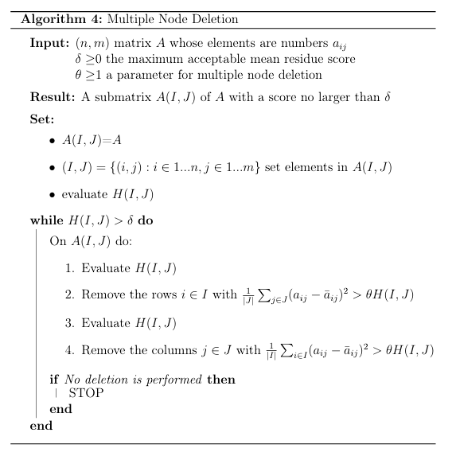

# Documentation

## Implemented functions

### Utility functions

- **create_bicluster** <- function(data, row_var, col_var, time_var, value_var)
    - returns a bicluster, that basically is a 3d array
    - Reference in [1]: definition 2.1
- **compute_bicluster_properties** <- function(bicluster)
    - returns the bicluster properties $\mu^{IJ}(t), \ \alpha_i^{IJ}(t), \ \beta_j^{IJ}(t)$
    - Reference in [1]: definition 2.1
- **compute_h_score** <- function(bicluster, mu_IJ, alpha_IJ, beta_IJ)
    - returns the H score of a bicluster
    - Reference in [1]: Definition 2.2
- **compute_residual_scores** <- function(bicluster, mu_IJ, alpha_IJ, beta_IJ)
    - returns the a residual matrix $\in \mathbb R^{|I|\times|J|}$ for each curve $f_{ij}$, computed as
        
        $$
         res_{ij}=\Vert f_{ij}-\bar f_{ij}\Vert_{L2}^2 = \int_t \Big\vert f_{ij}(t)-\Big(\mu_{IJ}(t)+\alpha_i^{IJ}(t)+\beta_j^{IJ}(t)\Big)\Big|^2
        $$
        
- **get_scores** <- function(bicluster)
    - returns:
        - H: the average of all the residuals of the matrix (corresponding to H-score)
        - row: the average of the residuals per row
        - col: the average of the residuals per column
    - Reference in [1]: see page 8

### FunCC algorithm utilities

- **delete_rows** <- function(bicluster, theta)
    - Returns the bicluster without the rows whose score is $\geq \theta H$
- **delete_cols** <- function(bicluster, theta)
    - Returns the bicluster without the columns whose score is $\geq \theta H$
- **find_worst_node** <- function(bicluster, min_rows=2, min_cols=2)
    - Finds the node (row or column) that has the higher H-score in the bicluster. If the bicluster is too small, it doesn’t return anything (null return).
    - Returns a list, representing a node:
        - type: “row” or “col”, specifies the node type.
        - index: specifies the position in the bicluster
        - score: specifies the H-score of the found node
- **remove_node** <- function(bicluster, node)
    - Returns a bicluster without the specified node
- **score_new_rows** <- function(full, bicluster, mu_IJ, alpha_IJ, beta_IJ)
    - Given the full dataset (as bicluster) and a bicluster, returns the scores that the columns present in the full bicluster would have in the other bicluster.
- **score_new_cols** <- function(full, bicluster, mu_IJ, alpha_IJ, beta_IJ)
    - as before but for columns
- **add_rows** <- function(full, bicluster)
    - returns a new bicluster with added rows that do not increase the H score.
- **add_cols** <- function(full, bicluster)
    - the same as before but for columns
- **bicluster_indices** <- function(M, bic)
    - Translates a bicluster’s row and columns into their positions in the full array M
- **mask_bicluster** <- function(M, bic)
    - overwrites the cells that belong to a bicluster with random numbers, so the algorithm can’t find the same bicluster again. It returns the modified copy of M, and the original is left untouched.
- **assigned_matrix** <- function(M, biclusters)
    - returns an $|I|\times|J|$ matrix, whose elements are boolean values telling if an element is already assigned to a bicluster or not.
- **get_unassigned** <- function(M, biclusters)
    - Returns the (row, columns) cells that don’t belong to any bicluster (i.e. not assigned elements).
- **is_empty_bicluster** <- function(M)
    - Tells if a bicluster is empty…
- refine_bicluster <- function(M, delta, theta)
    - Implements the FunCC main sequence of phases (MND, SND and NA)
- **monitor_iteration** <- function(A, biclusters, history, delta)
    - creates a plot over the iteration of the funCC algorithm, with the biclusters found and the average H-score curve
- **run_funCC** <- function(A, delta, theta, maxIter, min_rows = 2, min_cols = 2, max_fails = 5, monitor = TRUE, plot_every = 1)
    - main loop of FunCC algorithm.
    - Arguments
        - A: the full dataset (the I x J x T array).
        - delta: the maximum acceptable H-score for a bicluster.
        - theta: the parameter for multiple node deletion (passed on to refine_bicluster).
        - maxIter: the maximum number of iterations.
        - min_rows, min_cols: the smallest bicluster you accept (default 2 and 2).
        - max_fails: how many consecutive rejected biclusters are tolerated before stopping.
        - monitor, plot_every: whether to redraw the figure, and how often (every plot_every iterations).

### FunCC algorithm phases

- **multiple_node_deletion** <- function(bicluster, delta, theta)
    
    
    
- **single_node_deletion** <- function(bicluster, delta, min_rows = 2, min_cols = 2)
    
    
    
- **node_addition** <- function(full, bicluster)
    
    
    

## Mentioned definitions / algorithms

## Article

- [1] [FunCC: A new bi-clustering algorithm for functional data with misalignment](https://re.public.polimi.it/handle/11311/1205176)